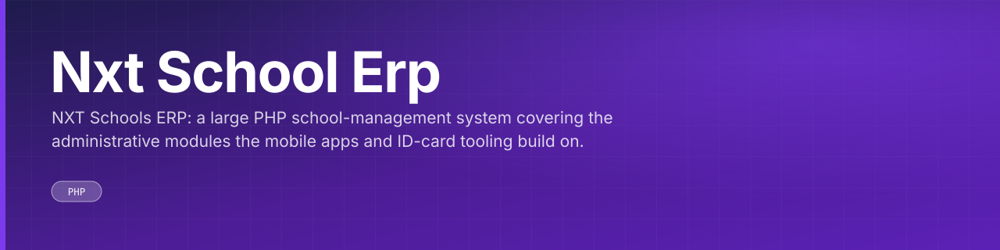
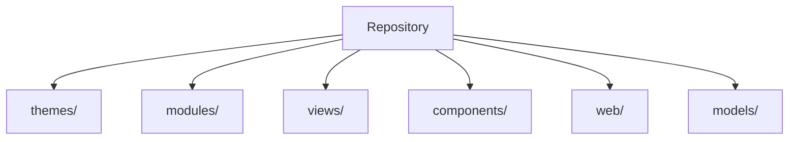

<div align="center">



NXT Schools ERP: a large PHP school-management system covering the administrative modules the mobile apps and ID-card tooling build on.

<br>


 

</div>

---

## What this is

The core NXT Schools ERP, a PHP application and by far the largest repository here at over 14,000 tracked files. This is the administrative system that the Flutter apps (parent-teacher, hostel, bus tracking) and the ID-card software integrate against.

The code is laid out as:

- `views/` — views
- `components/` — UI components
- `models/` — data models
- `migrations/` — database migrations
- `controllers/` — controllers
- `config/` — configuration

<div align="center">

|  |
|:--:|
| **14** |
| docs |

</div>

---

## Architecture



<sub>Derived from the directories present in this repository.</sub>

---

## Getting started

```bash
git clone https://github.com/cubixso-organisation/nxt-school-erp.git
cd nxt-school-erp
npm install
```

Configuration comes from the environment. Copy the checked-in template and fill in your own values:

```bash
cp .env.example .env.local
```

---

## Project structure

| Path | Contents | Files |
|---|---|---|
| `themes/` | — | 12020 |
| `modules/` | — | 2266 |
| `views/` | views | 47 |
| `components/` | UI components | 42 |
| `web/` | — | 37 |
| `models/` | data models | 28 |
| `migrations/` | database migrations | 19 |
| `controllers/` | controllers | 7 |
| `config/` | configuration | 6 |
| `forms/` | — | 5 |
| `traits/` | — | 3 |
| `widgets/` | — | 3 |
| `i18n/` | — | 2 |
| `commands/` | — | 1 |

<sub>14515 tracked files in total.</sub>

---

<div align="center">
<sub><a href="https://github.com/cubixso-organisation/nxt-school-erp">cubixso-organisation/nxt-school-erp</a></sub>
</div>
